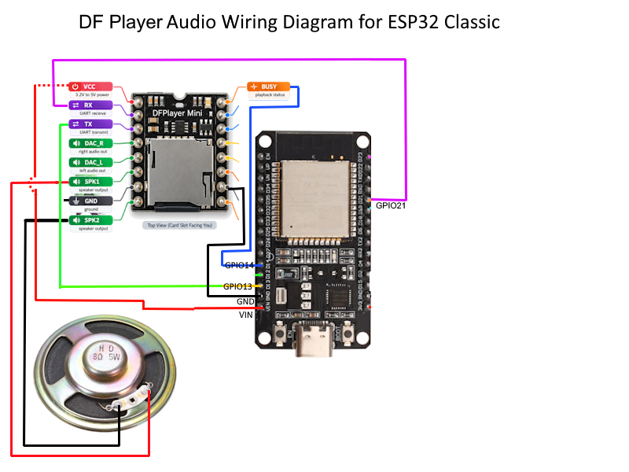
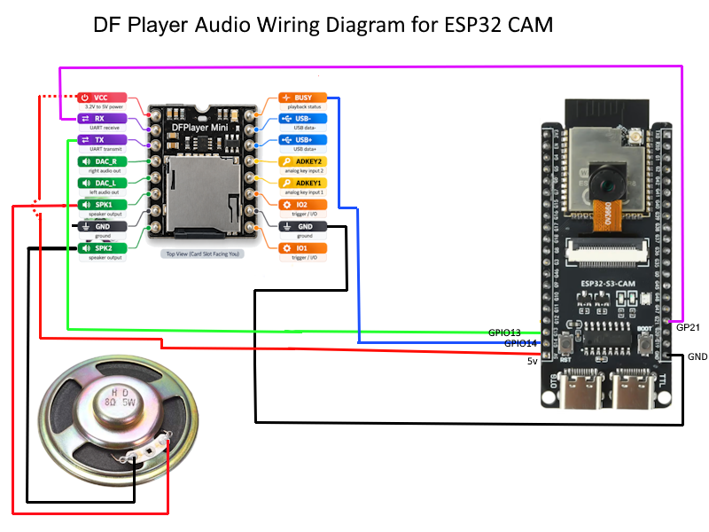

# DFPlayer Audio Installation Guide
## Classic ESP32, ESP32-S3 N16R8, and ESP32-S3 CAM N16R8

**For PMT firmware 3.4.3**

This guide is written for installers. Use the section for your board and wire it exactly as shown.

DFPlayer support in PMT is intentionally simple. It is designed to play individual MP3 sound effects assigned to `FX1` through `FX12`.

**DFPlayer is NOT intended to perform full locomotive lifecycle audio.**

With `CV401=1`, the firmware intentionally keeps DFPlayer independent of locomotive lifecycle/state audio. It is intended for simple, individual sounds triggered by FX commands rather than automatic startup, shutdown, idle/notch, or other locomotive-state sound sequences.

DFPlayer with PMT is intended for sounds such as:

- horn or whistle clips
- bell clips
- announcements
- coupler sounds
- air-release sounds
- switcher or accessory sounds
- other individual effects that you want to trigger from an FX command

The DFPlayer backend can play **one sound at a time**.

## Bill of Materials

For a DFPlayer audio installation:

- **Classic ESP32-WROOM-32 / WROOM-32E**, **ESP32-S3 N16R8**, or **ESP32-S3 CAM N16R8**
- **DFPlayer Mini**
- **microSD card inserted in the DFPlayer Mini**
- **speaker compatible with the DFPlayer SPK1/SPK2 output**
- jumper wires or soldered connections

The supplied wiring diagrams show the speaker connected directly between **SPK1** and **SPK2**.

**The ESP32 does not read the DFPlayer sound card.** The DFPlayer module reads its own microSD card and the ESP32 tells the DFPlayer which numbered track to play over UART.

---

# 1. Identify Your Board

The `CV401=1` DFPlayer preset uses the same default UART and BUSY GPIO assignments on the supported Classic and S3 builds.

| Board | DFPlayer sound card | Default DFPlayer GPIOs |
|---|---|---|
| **Classic ESP32-WROOM-32 / WROOM-32E** | microSD card in DFPlayer | TX `GPIO21`, RX `GPIO13`, BUSY `GPIO14` |
| **ESP32-S3 N16R8 — Standard** | microSD card in DFPlayer | TX `GPIO21`, RX `GPIO13`, BUSY `GPIO14` |
| **ESP32-S3 CAM N16R8** | microSD card in DFPlayer | TX `GPIO21`, RX `GPIO13`, BUSY `GPIO14` |

> GPIO numbers in this guide are the ESP32 GPIO numbers. Do not count connector pins from one end of the board.

**Important for the ESP32-S3 CAM:** The CAM board's onboard microSD slot is **not used for DFPlayer audio**. DFPlayer audio files must be on the microSD card inserted in the **DFPlayer Mini**.

---

# 2. DFPlayer Mini

PMT communicates with the DFPlayer over **UART2 at 9600 baud, 8N1**.

The firmware uses:

- ESP32 TX -> DFPlayer RX
- DFPlayer TX -> ESP32 RX
- DFPlayer BUSY -> ESP32 input
- common GND
- the DFPlayer's own microSD card for MP3 files
- DFPlayer SPK1/SPK2 for direct speaker output

The default `CV401=1` preset is:

| CV | DFPlayer meaning | Preset |
|---:|---|---:|
| CV401 | Audio backend | `1` |
| CV402 | Master volume | `15` |
| CV403 | ESP32 TX -> DFPlayer RX | `GPIO21` |
| CV404 | Unused by DFPlayer | `-1` |
| CV405 | Unused by DFPlayer | `-1` |
| CV406 | Unused by DFPlayer | `-1` |
| CV407 | ESP32 RX <- DFPlayer TX | `GPIO13` |
| CV408 | DFPlayer BUSY input | `GPIO14` |
| CV409 | DFPlayer replay restart trim | `250 ms` |

`CV401=1` applies these DFPlayer-specific values automatically.

## BUSY pin

The BUSY connection is important for replay/loop behavior.

The firmware configures the BUSY pin as `INPUT_PULLUP` and treats **LOW as playing/busy**.

With BUSY connected, PMT can detect when a DFPlayer track ends and restart a replay track. Without a configured BUSY pin, the DFPlayer backend falls back to one-shot behavior for loop requests.

---

# 3. Classic ESP32-WROOM-32 / WROOM-32E

Use this section for the **Classic ESP32**.

You need:

- Classic ESP32
- DFPlayer Mini
- microSD card in the DFPlayer
- speaker
- common ground between ESP32 and DFPlayer

## DFPlayer wiring

| DFPlayer Mini | Classic ESP32 |
|---|---:|
| RX | **GPIO21** — ESP32 TX |
| TX | **GPIO13** — ESP32 RX |
| BUSY | **GPIO14** |
| GND | **GND** |
| VCC | Connect to the power connection shown in the supplied wiring diagram |
| SPK1 | Speaker terminal 1 |
| SPK2 | Speaker terminal 2 |

**RX and TX are crossed:** ESP32 TX goes to DFPlayer RX, and DFPlayer TX goes to ESP32 RX.

## ESP32 Classic Wiring Diagram


## Classic quick check

Before power-on:

- [ ] DFPlayer RX -> ESP32 GPIO21
- [ ] DFPlayer TX -> ESP32 GPIO13
- [ ] DFPlayer BUSY -> ESP32 GPIO14
- [ ] DFPlayer GND -> ESP32 GND
- [ ] DFPlayer VCC is connected as shown in the wiring diagram
- [ ] speaker is connected across DFPlayer SPK1 and SPK2
- [ ] microSD card containing the numbered MP3 files is inserted in the DFPlayer
- [ ] the sound card is **not** connected to the ESP32 as an SPI SD card

---

# 4. ESP32-S3 N16R8 — Standard Board

Use this section for the **standard ESP32-S3 N16R8**.

The DFPlayer preset uses the same DFPlayer GPIO assignments as the Classic ESP32.

You need:

- ESP32-S3 N16R8
- DFPlayer Mini
- microSD card in the DFPlayer
- speaker
- common ground between ESP32 and DFPlayer

## DFPlayer wiring

| DFPlayer Mini | Standard ESP32-S3 |
|---|---:|
| RX | **GPIO21** — ESP32 TX |
| TX | **GPIO13** — ESP32 RX |
| BUSY | **GPIO14** |
| GND | **GND** |
| VCC | Use the appropriate board supply for your DFPlayer module |
| SPK1 | Speaker terminal 1 |
| SPK2 | Speaker terminal 2 |

**RX and TX are crossed:** ESP32 TX goes to DFPlayer RX, and DFPlayer TX goes to ESP32 RX.

## Standard S3 quick check

Before power-on:

- [ ] DFPlayer RX -> ESP32 GPIO21
- [ ] DFPlayer TX -> ESP32 GPIO13
- [ ] DFPlayer BUSY -> ESP32 GPIO14
- [ ] DFPlayer GND -> ESP32-S3 GND
- [ ] speaker is connected across DFPlayer SPK1 and SPK2
- [ ] microSD card containing the numbered MP3 files is inserted in the DFPlayer

---

# 5. ESP32-S3 CAM N16R8

Use this section for the **ESP32-S3 CAM N16R8**.

You need:

- ESP32-S3 CAM N16R8
- DFPlayer Mini
- microSD card in the DFPlayer
- speaker
- common ground between ESP32-S3 CAM and DFPlayer

## DFPlayer wiring

| DFPlayer Mini | ESP32-S3 CAM |
|---|---:|
| RX | **GPIO21** — ESP32 TX |
| TX | **GPIO13** — ESP32 RX |
| BUSY | **GPIO14** |
| GND | **GND** |
| VCC | Connect to the power connection shown in the supplied wiring diagram |
| SPK1 | Speaker terminal 1 |
| SPK2 | Speaker terminal 2 |

## ESP32 CAM Wiring Diagram


**Important correction for DFPlayer installation:** The ESP32-S3 CAM onboard SD-card slot does **not** replace the DFPlayer sound card. The DFPlayer reads audio from the microSD card installed in the **DFPlayer Mini itself**. The ESP32-S3 CAM onboard SD slot is not used for DFPlayer audio playback.

## S3 CAM quick check

Before power-on:

- [ ] DFPlayer RX -> ESP32-S3 CAM GPIO21
- [ ] DFPlayer TX -> ESP32-S3 CAM GPIO13
- [ ] DFPlayer BUSY -> ESP32-S3 CAM GPIO14
- [ ] DFPlayer GND -> ESP32-S3 CAM GND
- [ ] DFPlayer VCC is connected as shown in the wiring diagram
- [ ] speaker is connected across DFPlayer SPK1 and SPK2
- [ ] microSD card containing the numbered MP3 files is inserted in the DFPlayer
- [ ] you are not relying on the CAM onboard SD slot for DFPlayer audio

---

# 6. Prepare DFPlayer Sounds

DFPlayer uses numbered MP3 tracks.

PMT's DFPlayer backend sends the DFPlayer **MP3-folder track command**, so the sound files are addressed as:

```text
/mp3/####.mp3
```

Examples:

```text
/mp3/0001.mp3
/mp3/0002.mp3
/mp3/0042.mp3
/mp3/0210.mp3
```

For PMT custom FX sounds, valid track numbers are:

```text
1 through 9999
```

The Function Data / Pin CV stores the numeric track number.

Examples:

| Function Data / Pin CV | DFPlayer file |
|---:|---|
| `1` | `/mp3/0001.mp3` |
| `2` | `/mp3/0002.mp3` |
| `42` | `/mp3/0042.mp3` |
| `210` | `/mp3/0210.mp3` |

PMT firmware does not mount or read the DFPlayer microSD card. The DFPlayer module itself reads and plays the files from its own card.

---

# 7. First Power-On

After all wiring is complete:

1. Insert the prepared microSD card into the **DFPlayer Mini**.
2. Check RX, TX, BUSY, GND, power, and speaker wiring.
3. Power on the ESP32.
4. Select the DFPlayer backend.
5. Enable audio.
6. Configure at least one FX function as a custom audio sound.
7. Trigger that FX function.

Use:

```text
CV400=0
CV401=1
CV400=1
```

`CV401=1` selects DFPlayer and applies the DFPlayer pin preset.

`CV400=1` enables audio.

The default DFPlayer master volume is:

```text
CV402=15
```

The supported volume range is `0` through `30`.

---

## Assign Sounds to FX Commands

This is the normal way to use DFPlayer in PMT.

With `CV401=1`, DFPlayer is intentionally restricted to the custom FX audio patterns:

| Pattern | Numeric value | Behavior |
|---|---:|---|
| `AUDIO_CUSTOM` | `103` | Play the selected track once |
| `AUDIO_CUSTOM_REPLAY` | `104` | Replay/loop the selected track while the FX function remains active |

Legacy text values are also accepted by the firmware:

- `AUDIO_CUSTOM` or `CUSTOM`
- `AUDIO_CUSTOM_REPLAY`, `CUSTOM_REPLAY`, `AUDIO_CUSTOM_LOOP`, or `CUSTOM_LOOP`

The numeric values are preferred for clear installer configuration.

## Function CV layout

Each FX slot uses a seven-CV block:

```text
Function base CV = 150 + ((FX number - 1) * 7)

+0 = name
+1 = data / GPIO / audio track number
+2 = pattern
+3 = direction
+4 = app flags
```

For DFPlayer custom audio:

- the **Data / Pin CV** becomes the DFPlayer track number
- the **Pattern CV** is `103` or `104`
- the normal **FWD / REV / BOTH** direction rule still applies

## Example — FX3 plays track 0001 once

FX3 uses:

- name: CV164
- track/data: CV165
- pattern: CV166
- direction: CV167

Configure it as:

```text
CV164=Horn
CV165=1
CV166=103
CV167=BOTH
```

Then:

```text
FX3=1
```

plays:

```text
/mp3/0001.mp3
```

Pattern `103` is a one-shot. If `FX3=1` is sent again while FX3 is already on, PMT retriggers the sound.

Sending:

```text
FX3=0
```

turns the function off and stops that custom-audio group if it is still active.

## Example — FX4 replays track 0002

FX4 uses:

- name: CV171
- track/data: CV172
- pattern: CV173
- direction: CV174

Configure it as:

```text
CV171=Bell
CV172=2
CV173=104
CV174=BOTH
```

Then:

```text
FX4=1
```

starts replaying:

```text
/mp3/0002.mp3
```

and:

```text
FX4=0
```

stops it.

Pattern `104` uses the DFPlayer BUSY signal to detect playback completion and restart the track. The default replay restart trim is `250 ms` through `CV409`.

## Direction-controlled sounds

Normal FX direction gating remains active.

For example:

```text
CV174=FWD
```

allows that FX4 sound only while the locomotive direction is forward.

Valid direction values used by PMT are:

```text
FWD
REV
BOTH
```

---

# 8. Troubleshooting

## No sound

Check:

1. `CV400=1`.
2. `CV401=1`.
3. DFPlayer RX is connected to ESP32 **GPIO21**.
4. DFPlayer TX is connected to ESP32 **GPIO13**.
5. DFPlayer GND and ESP32 GND are connected.
6. The microSD card is inserted in the **DFPlayer**, not just the ESP32-S3 CAM.
7. The file is in the DFPlayer MP3 folder using its four-digit track number.
8. The configured function track number is between `1` and `9999`.
9. The function pattern is `103` or `104`.
10. The function's direction setting allows it in the current locomotive direction.
11. The speaker is connected to DFPlayer SPK1/SPK2.

## FX turns on but DFPlayer does not play

Query the relevant function CVs and confirm:

- Data / Pin CV = desired track number
- Pattern CV = `103` or `104`
- Direction CV = `FWD`, `REV`, or `BOTH` as intended

Also confirm the corresponding file exists as:

```text
/mp3/####.mp3
```

Example for track `25`:

```text
/mp3/0025.mp3
```

## Replay pattern plays only once

For pattern `104`, check the BUSY connection first:

```text
DFPlayer BUSY -> ESP32 GPIO14
```

The firmware expects BUSY to go LOW while the DFPlayer is playing.

If the BUSY pin is not configured, the DFPlayer backend intentionally falls back to one-shot playback for a loop request.

## RX/TX wiring

UART wiring must be crossed:

```text
ESP32 GPIO21 TX -> DFPlayer RX
ESP32 GPIO13 RX <- DFPlayer TX
```

Do not wire TX-to-TX and RX-to-RX.

## ESP32-S3 CAM SD-card confusion

The CAM onboard SD slot is **not** the source of DFPlayer audio.

For DFPlayer:

```text
MP3 files -> microSD card -> DFPlayer Mini
```

not:

```text
MP3 files -> ESP32-S3 CAM onboard SD slot
```

## Lifecycle sounds do not run

This is expected with `CV401=1`.

The current firmware deliberately bypasses locomotive lifecycle/state audio when DFPlayer is selected and reconciles only:

```text
AUDIO_CUSTOM
AUDIO_CUSTOM_REPLAY
```

## Two sounds will not overlap

This is expected.

The DFPlayer backend advertises a maximum of **one simultaneous sound**. It is intended for simple FX-triggered playback, not multi-voice locomotive audio mixing.

---

# 9. Advanced Configuration
## Only use this section if you intentionally need to change the DFPlayer defaults

Most installations should set:

```text
CV401=1
```

and use the resulting preset unchanged.

## DFPlayer settings

| CV | Setting | DFPlayer preset |
|---:|---|---:|
| CV400 | Audio enable | Clean-reset default `0`; set `1` to enable. `CV401=1` does not force this value |
| CV401 | Backend | `1` |
| CV402 | Master volume | `15` |
| CV403 | ESP32 TX -> DFPlayer RX | `GPIO21` |
| CV404 | Unused by DFPlayer | `-1` |
| CV405 | Unused by DFPlayer | `-1` |
| CV406 | Unused by DFPlayer | `-1` |
| CV407 | ESP32 RX <- DFPlayer TX | `GPIO13` |
| CV408 | DFPlayer BUSY | `GPIO14` |
| CV409 | Loop/replay restart trim | `250 ms` |
| CV410 | Default audio priority | `30` |
| CV411 | Conflict policy | `1` |
| CV412 | Startup delay | `0 ms` |
| CV413 | Shutdown delay | `0 ms` |
| CV414 | Optional amp enable pin | `-1` |
| CV415 | Optional amp mute pin | `-1` |
| CV416 | Optional amp standby pin | `-1` |
| CV417 | Optional fault input pin | `-1` |

The DFPlayer driver clamps `CV409` to an effective range of `0` through `5000 ms`.

## Changing DFPlayer GPIOs

If you intentionally rewire the DFPlayer, change the backend-specific CVs to match the physical wiring:

```text
CV400=0
CV401=1
CV403=<ESP32 TX GPIO connected to DFPlayer RX>
CV407=<ESP32 RX GPIO connected from DFPlayer TX>
CV408=<ESP32 GPIO connected from DFPlayer BUSY>
CV400=1
```

Only change the DFPlayer-specific GPIO CVs when the physical wiring is intentionally changed.

---

# 10. One-Page Wiring and Setup Reference

## All supported boards with the default DFPlayer preset

```text
DFPlayer Mini                     ESP32
------------------------------------------------
RX          <------------------- GPIO21  (TX)
TX          -------------------> GPIO13  (RX)
BUSY        -------------------> GPIO14  (input)
GND         -------------------- GND
SPK1        -------------------- Speaker terminal 1
SPK2        -------------------- Speaker terminal 2
```

UART:

```text
UART2
9600 baud
8 data bits
no parity
1 stop bit
```

Select and enable DFPlayer:

```text
CV400=0
CV401=1
CV400=1
```

DFPlayer sound files:

```text
/mp3/0001.mp3
/mp3/0002.mp3
...
/mp3/9999.mp3
```

FX audio patterns:

```text
103 = AUDIO_CUSTOM         = play once
104 = AUDIO_CUSTOM_REPLAY  = replay/loop while FX is active
```

Example:

```text
CV164=Horn
CV165=1
CV166=103
CV167=BOTH

FX3=1
```

plays:

```text
/mp3/0001.mp3
```

**DFPlayer is for simple FX-triggered sound playback and is not intended to perform full locomotive lifecycle audio.**
