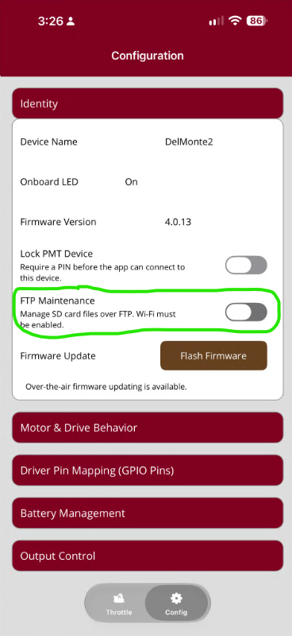

# FTP SD Card Maintenance Guide

Poor Man's Throttle (PMT) can temporarily expose the PMT-managed SD card as a standard FTP server. This lets you maintain files from a computer without removing the SD card from the PMT device.

FTP Maintenance is intentionally **not always running**. You enable it from the PMT app only when you need to work with files, and turning it off reboots the PMT device back into normal operation.



## Requirements

Before enabling FTP Maintenance:

- The PMT device must have an SD card available.
- Wi-Fi must be enabled in PMT configuration.
- The PMT device must be connected to Wi-Fi and have a valid IP address.
- Your computer must be able to reach the PMT device on the same network.

If Wi-Fi is disabled, the **FTP Maintenance** switch in the app is disabled.

> **Important:** FTP is plain, anonymous FTP intended for a trusted local network. Do not expose the PMT FTP server to the public Internet or forward FTP ports through your router.

## Enable FTP Maintenance

1. Connect the PMT app to the PMT device over BLE.
2. Open **Config**.
3. Expand **Identity**.
4. Turn on **FTP Maintenance**.
5. Read the warning and confirm that you want to continue.
6. Wait for the app to report that FTP is active and show the FTP endpoint.

The endpoint will look similar to:

```text
ftp://192.168.71.200/
```

The address is based on the IP address assigned to your PMT device.

## Manual BLE command control

The PMT app switch is the normal user interface for FTP Maintenance, but the firmware also exposes direct BLE commands for diagnostics, automation, and terminal use.

These commands are **BLE commands**. They are not FTP commands typed into Windows Explorer or an FTP client.

### Check FTP state

```text
FTP?
```

Typical responses include:

```text
FTP:OFF
FTP:ENTERING
FTP:ON IP=192.168.71.200 PORT=21 ACCESS=ANONYMOUS
FTP:ON WIFI=DISCONNECTED
FTP:REBOOT
```

### Enter FTP Maintenance

```text
FTP1
```

If the prerequisites are satisfied, PMT enters maintenance mode and starts the FTP server.

Common preflight errors include:

```text
ERR:FTP:NO_WIFI
ERR:FTP:NO_IP
ERR:FTP:NO_SD
ERR:FTP:BUSY
```

If startup fails after PMT has already latched maintenance mode, the error includes `REBOOT_REQUIRED`, for example:

```text
ERR:FTP:MEMORY REBOOT_REQUIRED
ERR:FTP:START REBOOT_REQUIRED
```

### Exit FTP Maintenance

```text
FTP0
```

When FTP is active, PMT replies:

```text
ACK:FTP0 REBOOT
```

and then reboots.

While FTP Maintenance is active, the read-only script-status query:

```text
SS?
```

returns:

```text
A:SS=FTP
```

Other normal PMT commands are blocked with:

```text
ERR:CMD:FTP_MAINT_ACTIVE
```

The FTP control commands are accepted only over BLE. If they are sent through another command transport, PMT returns:

```text
ERR:FTP:BLE_REQUIRED
```

## What happens when FTP is enabled

FTP Maintenance is a dedicated maintenance mode.

When it starts, PMT keeps only the services needed for BLE, Wi-Fi, the SD card, and FTP. Normal operating services are shut down so FTP can have exclusive access to the SD card.

While FTP Maintenance is active:

- BLE remains available.
- Wi-Fi remains connected.
- The SD card remains mounted.
- FTP becomes the only normal user of the SD filesystem.
- PMTPlayer audio is stopped and its runtime resources are released.
- Script playback and recording are stopped.
- SD logging and log-transfer activity are stopped.
- WebSocket command service and ESP-NOW are stopped.
- Normal throttle, FX, function, audio, script, configuration, and other operating commands are blocked.
- On a throttle, the locomotive is stopped before FTP becomes active and cannot be commanded again until the PMT device reboots.

Because normal commands are intentionally blocked, the PMT app may report command or communication errors while FTP Maintenance is active. The normal status query reports the FTP maintenance state rather than normal operating status.

## Windows 11

Windows 11 File Explorer can connect directly to the PMT FTP server.

1. Open **File Explorer**.
2. Enter the FTP endpoint in the address bar, for example:

   ```text
   ftp://192.168.71.200/
   ```

3. Press **Enter**.
4. Browse the SD card and copy, replace, rename, or delete files as needed.

PMT uses standard **anonymous FTP**, so no PMT username or password is required.

## macOS

Use a standard FTP client on macOS for full read/write file management.

Configure the client with:

- **Protocol:** FTP
- **Host:** the IP address shown by the PMT app
- **Port:** 21
- **Login:** Anonymous

Use the FTP endpoint shown by the app as the authoritative address for that session.

## Files you can maintain

FTP exposes the SD card managed by the PMT firmware. Typical content can include:

### PMTPlayer audio

PMTPlayer audio files can be copied or replaced through FTP.

Typical PMTPlayer audio folders are:

```text
/diesel
/steam
/audio
```

`/diesel` and `/steam` are the sound-pack roots. `/audio` is the shared final fallback for custom audio. Custom tracks are resolved as configured sound-pack folder → opposite sound-pack folder → `/audio`.

After changing PMTPlayer audio files, turn FTP Maintenance off and allow the PMT device to reboot before testing audio.

### Scripts

Firmware script files stored on the SD card can be maintained through FTP, including files under:

```text
/scripts
```

Scripts are not executed while FTP Maintenance is active. Reboot the PMT device before testing changed scripts.

### Logs

Files under folders such as:

```text
/logs
```

can be downloaded through FTP.

PMT SD logging is stopped before FTP gets exclusive access to the card, so a log file is not being actively written while you manage it through FTP.

## DFPlayer Mini is different

FTP does **not** provide access to the microSD card inserted in a DFPlayer Mini.

The DFPlayer Mini owns and reads its own microSD card directly. The ESP32 does not mount that card as the PMT filesystem.

Therefore:

- **PMTPlayer SD card:** can be maintained through PMT FTP.
- **DFPlayer Mini microSD card:** must still be removed/prepared using the normal DFPlayer workflow.

## Finish the FTP session

When you are finished working with files:

1. Close or disconnect the FTP client on the computer.
2. Return to **Config → Identity** in the PMT app.
3. Turn **FTP Maintenance** off.
4. PMT closes FTP, flushes/closes its file activity, and reboots.

The reboot is intentional. FTP Maintenance is not persisted. After reboot, the PMT device returns to its normal configured operating state.

Do not expect normal throttle or controller operation to resume without the reboot.

## Troubleshooting

### The FTP Maintenance switch is disabled

Wi-Fi is disabled in PMT configuration. Enable and configure Wi-Fi first.

### FTP will not start

The firmware checks the required runtime conditions before entering maintenance mode. FTP can be refused when, for example:

- no SD card is available;
- Wi-Fi is not connected;
- the PMT device does not have a usable IP address;
- the device does not have enough free runtime memory to start FTP safely.

If preflight fails, PMT does not enter FTP Maintenance mode.

### Windows can reach the device but cannot open a folder

Verify that you are using the endpoint shown by the PMT app and that the folder actually exists on the SD card.

The FTP server accepts normal absolute directory paths such as:

```text
/scripts/
/logs/
/diesel/
/steam/
/audio/
```

### Normal PMT commands stop working

This is expected. Once FTP Maintenance is active, normal PMT commands are intentionally locked out until reboot.

### Wi-Fi drops while FTP is active

PMT remains latched in FTP Maintenance mode. It does not restore throttle or controller operation merely because Wi-Fi was lost. BLE remains available and the device remains in the safe maintenance state.

### Audio does not play while FTP is active

This is expected. Audio is deliberately shut down before FTP receives exclusive access to the SD card.

Turn FTP Maintenance off and allow the PMT device to reboot before testing audio.

## Safety summary

FTP Maintenance is designed around one rule: **only FTP should be modifying the PMT SD filesystem while FTP Maintenance is active**.

Enable it only when you intend to maintain files, finish your file work, then turn it off so PMT can reboot into normal operation.
