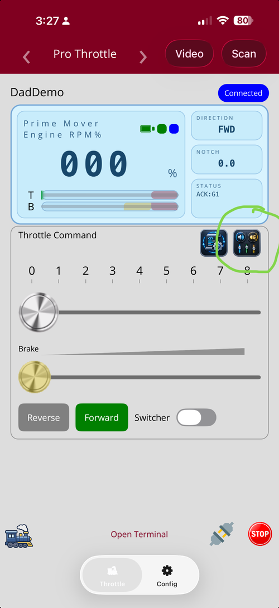
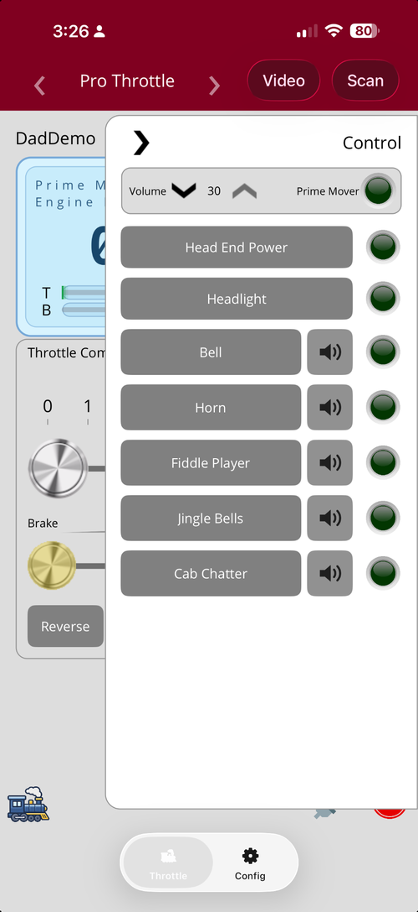
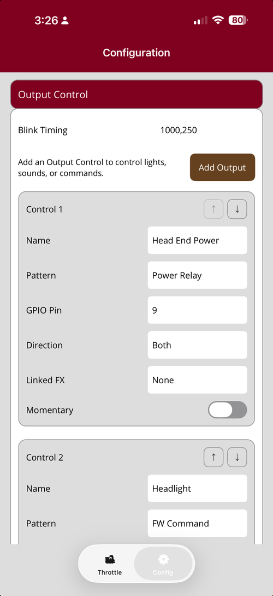
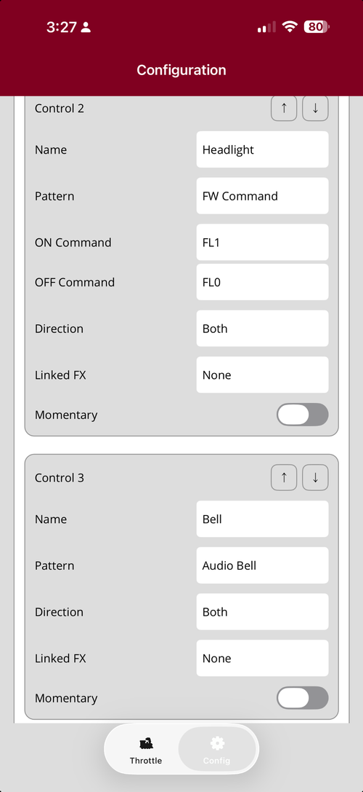
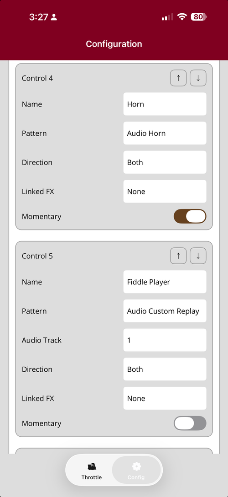
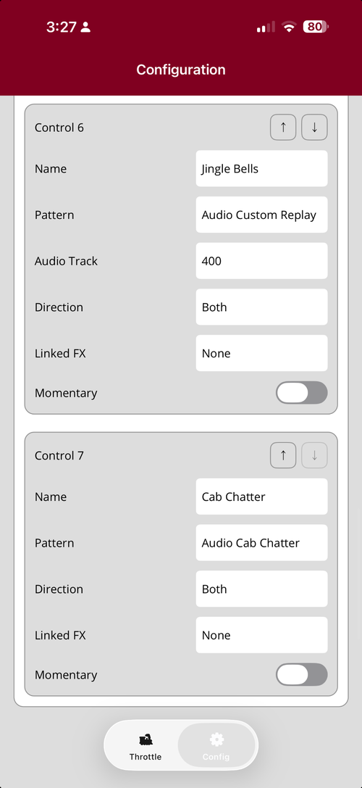

# Poor Man's Throttle — Output Control User Guide

**Applies to:** App version **4.2.4** with firmware **3.6.1**  
**Minimum firmware supported by this app:** **3.6.1**

> **Important:** `Control 1`, `Control 2`, and so on describe the order you see on the Configuration screen. They are **not automatically the same as firmware FX1, FX2, and so on**. App-based controls do not use a firmware FX slot, and reordering two firmware-based controls can move their complete settings from one FX slot to another.

---

## Contents

1. [Getting to Output Controls](#1-getting-to-output-controls)
2. [Understanding Output Controls](#2-understanding-output-controls)
3. [Configuring an Output Control](#3-configuring-an-output-control)
4. [Reordering Output Controls](#4-reordering-output-controls)
5. [Pattern Quick Reference](#5-pattern-quick-reference)
6. [LED and Power Output Patterns](#6-led-and-power-output-patterns)
7. [Audio Patterns](#7-audio-patterns)
8. [Command and HTTP Patterns](#8-command-and-http-patterns)
9. [Using Output Controls on a Locomotive Throttle](#9-using-output-controls-on-a-locomotive-throttle)
10. [Using Output Controls on a Consist](#10-using-output-controls-on-a-consist)
11. [Example Configuration from the Screenshots](#11-example-configuration-from-the-screenshots)
12. [Common Setup Examples](#12-common-setup-examples)
13. [Troubleshooting and Limits](#13-troubleshooting-and-limits)
14. [Quick Reference](#14-quick-reference)

---

# 1. Getting to Output Controls

On the **Pro Throttle**, tap the small Output Control button near the upper-right corner of the **Throttle Command** area.

The table below describes where the **on-screen Output Control panel** is shown:

| Screen | On-screen Output Control panel |
|---|---|
| Pro Throttle | Yes |
| Standard Throttle | Yes |
| Novice Throttle | No |
| Physical Throttle | No |
| Standard Consist | Yes |
| Novice Consist | No |
| Physical Consist | No |

> **Novice Throttle, Physical Throttle, Novice Consist, and Physical Consist do not expose an on-screen Output Control panel.** This does **not** mean a mapped physical device cannot operate Output Controls. Physical devices are mapped through the app and can operate supported Output Controls through those mappings. See [Using a physical device mapped in the app](#using-a-physical-device-mapped-in-the-app).

On the Pro and Standard locomotive throttles, supported audio controls can also show a separate speaker/volume button. Those per-function speaker buttons are not shown on consist Output Control panels.

Each Output Control button shows its current App state:

- **Green** means the control is ON.
- **Gray** means the control is OFF.
- The round indicator at the right also changes between the ON and OFF light images.

For **Device Command** and **Device FX**, the target device name can appear under the button as `↗ Target Name`. If that target is not available, the button is disabled and shown dimmed instead of sending the command somewhere else.

---

# 2. Understanding Output Controls

There are two different kinds of Output Controls. This difference affects where the setting is stored, how it runs, whether it uses one of the 12 firmware FX slots, and how it behaves in a consist.

## Firmware Output Controls

A Firmware Output Control uses one of the locomotive's **12 firmware function slots: FX1 through FX12**.

These Patterns are Firmware Output Controls:

- Power Relay
- LED Solid
- LED Double Blink
- LED FRED
- LED Blink +
- LED Blink -
- LED Ditch +
- LED Ditch -
- LED Strobe +
- LED Strobe -
- LED Rotary +
- LED Rotary -
- LED Mars +
- LED Mars -
- LED Gyralite +
- LED Gyralite -
- LED Firebox Flicker
- LED Lantern Flicker
- LED Dynamo
- LED Incandescent
- Audio Bell
- Audio Horn
- Audio Cab Chatter
- Audio Custom
- Audio Custom Replay
- FW Command

When you use one of these buttons, the app turns the matching firmware FX slot ON or OFF. The locomotive firmware then performs the actual Pattern.

This means the locomotive itself handles things such as:

- LED timing
- LED brightness effects
- audio playback behavior
- Direction restrictions
- FW Command execution

### What this means for you

- Each Firmware Output Control uses one of the 12 available FX slots.
- LED and audio effects continue to run in the locomotive after you turn them on.
- Direction restrictions are enforced by the locomotive.
- The locomotive decides whether a GPIO pin can actually be used.
- FW Command is executed by the locomotive itself.
- A Firmware Output Control can also be assigned to a supported physical device through the app's **Physical Controls** mapping.

## App Output Controls

These Patterns are App Output Controls:

- APP Command
- Device Command
- Device FX
- Relay Command
- HTTP Request

They **do not use one of the locomotive's FX1-FX12 slots**.

Instead, the app stores the control and decides where the action should go when you press the button.

### What this means for you

- You can add App Output Controls even when all 12 firmware FX slots are already used.
- They are available through the app rather than being standalone firmware FX functions.
- App Output Controls can also be assigned to a supported physical device through the app's **Physical Controls** mapping. The physical device still operates them through the app; it does not bypass the app and talk directly to the locomotive.
- APP Command, Device Command, and Relay Command can use Linked FX and Momentary.
- Device FX follows the behavior of the control it points to rather than having its own Direction, Linked FX, or Momentary settings.
- HTTP Request has no Direction setting. **Dual Request** can use Linked FX and Momentary; **Single Request** is intentionally stateless and has neither.

## Quick comparison

| Feature | Firmware Output Control | App Output Controls |
|---|---|---|
| Uses FX1-FX12 | Yes | No |
| Runs on the locomotive | Yes | No, the app routes the action |
| Direction | Configure it directly on the control | APP Command, Device Command, Relay Command, and HTTP Request do not have Direction. **Device FX follows the target control's Direction behavior.** |
| Linked FX | Configure it directly on the control | APP Command, Device Command, and Relay Command can configure Linked FX directly. **HTTP Request can configure Linked FX only in Dual Request mode.** Device FX has no separate Linked FX setting; it follows the target control's behavior. |
| Momentary | Configure it directly on the control | APP Command, Device Command, and Relay Command can configure Momentary directly. **HTTP Request can configure Momentary only in Dual Request mode.** Device FX has no separate Momentary setting; it follows the target control's behavior. |
| Can still be added after all 12 FX slots are used | No | Yes |

## Where the settings are stored

You do not need to manage these settings manually, but knowing where they live helps explain why App and Firmware Output Controls behave differently.

## Where Firmware Output Control settings are stored

The locomotive stores the settings for its 12 firmware FX slots, including:

- Name
- Pattern
- GPIO / Audio Track / command data
- Direction
- settings needed for Linked FX and Momentary

These controls belong to the locomotive's firmware configuration.

## Where App Output Control settings are stored

The app stores:

- APP Command controls
- Device Command controls
- Device FX controls
- Relay Command controls
- HTTP Request controls, including Behavior, URL, Method, Headers, body settings, and the separate On/Off request definitions when Dual Request is used
- the combined display order of Firmware and App Output Controls
- the app-side information needed to keep Power Relay and LED Solid labeled the way you selected them

This is why App Output Controls can exist without using a firmware FX slot.

## Using a physical device mapped in the app

Poor Man's Throttle does not use an independent third-party controller that talks directly to the locomotive's Output Controls. A supported physical device is **mapped in the app**, and the app routes that physical input to the selected throttle or consist action.

### On a locomotive throttle

The app can expose configured standalone Output Controls as named choices in **Physical Controls** mapping.

That includes:

- Firmware Output Controls, such as LED, audio, Power Relay, and FW Command
- APP Command
- Device Command
- Device FX
- Relay Command
- HTTP Request

A mapped physical button or input operates the selected Output Control through the same throttle action used by the app. This means the Output Control keeps its normal behavior:

- a normal control toggles when the physical input is released;
- a Momentary control turns ON when pressed and OFF when released;
- Device Command still goes to its selected Target Device;
- Device FX still operates its selected Target FX and follows the target control's applicable behavior;
- Relay Command still uses its relay routing;
- HTTP Request is still sent by the app to its configured URL;
- Single Request fires once from the mapped non-Momentary action, while Dual Request follows its configured toggle or Momentary behavior;
- Linked FX behavior is still applied where the selected Output Control supports it.

An Output Control that is being used as a hidden **Linked FX target** is not offered as a separate named physical-control choice. If a target-dependent control such as Device FX is unavailable at runtime, the mapped physical action cannot operate it until that target becomes available again.

### On a consist

Physical Controls can also be mapped for a consist. The named Output Control choices are built from the **lead locomotive's configuration**, just as the consist Output Control behavior is based on the lead.

The current per-consist named mapping list includes:

- Firmware Output Controls
- APP Command
- Device Command
- Relay Command
- HTTP Request

**Device FX is available on the Standard Consist on-screen Output Control panel, but it is not currently offered as a direct named choice in the per-consist Physical Controls mapping list.**

A mapped HTTP Request on a consist is still executed once by the app. It is not sent separately by each consist member.

The physical device still works through the app. It does not send an FX command directly to the locomotive on its own.

---

# 3. Configuring an Output Control

Open **Configuration**, then expand **Output Control**.

At the top you will see:

- **Blink Timing**
- **Add Output**
- your current Output Controls in their display order

Each control shows:

- `Control N`, where `N` is its current position in the list
- an **Up** button
- a **Down** button
- **Name**
- **Pattern**
- any additional settings required by that Pattern

Depending on the Pattern you choose, you may also see:

- Target Device
- Target FX
- GPIO Pin
- Audio Track
- Command On/Off
- ON Command
- OFF Command
- HTTP Behavior
- URL
- Method
- Headers
- Request Body / Data
- Direction
- Linked FX
- Momentary

The Up button is disabled for the first item, and the Down button is disabled for the last item.

## Adding a control

Tap **Add Output**.

A new control starts with:

- no Name
- no Pattern
- Direction = Both
- Linked FX = None
- Momentary = Off

Choose the Pattern and complete the settings that appear for that Pattern.

### If at least one firmware FX slot is available

You can choose from the Firmware and App Patterns.

### If all 12 firmware FX slots are already used

You can still add:

- APP Command
- Device Command
- Device FX
- Relay Command
- HTTP Request

These do not require a firmware FX slot.

A new Firmware Output Control uses the first available firmware FX slot, but its `Control N` number still represents its place in the displayed Output Control list.

## What each setting means

### Name

**Name** is the text shown on the throttle or consist button.

Examples in this guide:

- Head End Power
- Headlight
- Bell
- Horn
- Fiddle Player
- Jingle Bells
- Cab Chatter

For Device Command and Device FX, the target device name may also appear under the control name.

### Pattern

**Pattern** determines what the control does.

It also determines which additional fields are shown.

For example:

- an LED Pattern needs a GPIO Pin;
- Audio Custom needs an Audio Track;
- Device Command needs a Target Device and command pair;
- Device FX needs a Target Device and Target FX;
- HTTP Request needs a valid Behavior and one or two valid HTTP request definitions, depending on the Behavior.

### Blink Timing

**Blink Timing** is entered as:

`period,on-time`

Example:

`1000,250`

This means:

- total blink cycle = **1000 ms**
- output ON time during each cycle = **250 ms**

The period can be **1 through 60000 ms**. The ON time must be at least 1 ms and cannot be longer than the full period.

Blink Timing is used by:

- LED Blink +
- LED Blink -

The `-` version runs half a cycle out of phase with the `+` version.

Other flashing Patterns such as Ditch, Strobe, FRED, Rotary, Mars, and Gyralite use their own built-in timing and are not changed by the Blink Timing field.

### GPIO Pin

GPIO Pin is shown for the LED and Power Relay Patterns.

Enter the GPIO number connected to the output you want to control.

The app checks that the entry is a positive number. The locomotive then performs the final hardware check before using the pin.

A pin can be rejected if, for example:

- that pin is disabled;
- it is reserved for the firmware's BLE status LED;
- it cannot be used as a normal output;
- another active LED Output Control is already using the same pin.

So a number can be accepted by the Configuration screen but still be unavailable on the locomotive hardware.

### Audio Track

Audio Track is shown for:

- Audio Custom
- Audio Custom Replay

Valid values are **1 through 9999**.

Enter the track number you want that Output Control to play.

### Command On/Off

APP Command and Device Command use one field containing both commands:

`ON-command,OFF-command`

Example format:

`ABC1,ABC0`

The text before the comma is sent when the Output Control turns ON.  
The text after the comma is sent when it turns OFF.

Both commands must be present.

### ON Command and OFF Command

FW Command and Relay Command show separate **ON Command** and **OFF Command** fields.

For FW Command:

- ON Command runs when the function becomes active.
- OFF Command runs when it becomes inactive.

For Relay Command:

- choose the relay target;
- enter the command to send for ON;
- enter the command to send for OFF.

### Target Device

Target Device is used by:

- Device Command
- Device FX
- Relay Command

For Device Command and Device FX, choose the other device you want this button to control.

For Relay Command, choose a device that has a valid ESP-NOW relay address saved.

### Target FX

Target FX is shown only for **Device FX**.

After choosing a Target Device, choose the Output Control on that device that you want this button to operate.

A control that is already being used as a hidden Linked FX target is not offered as a normal Device FX target.

HTTP Request controls are also not offered as Device FX targets.

### HTTP Behavior

HTTP Request has two Behavior choices:

- **Single Request** — each activation sends one request. It has no latched ON/OFF state, no Momentary setting, and no Linked FX.
- **Dual Request** — provides a **Request / On Request** and an **Off Request**. It behaves like an ON/OFF control and can use Linked FX and Momentary.

### URL

Enter an absolute `http://` or `https://` URL.

HTTPS is allowed for any otherwise valid host. Cleartext HTTP is restricted to local/private destinations. The detailed URL rules are listed in [HTTP Request](#http-request).

### Method

Choose:

- GET
- POST
- PUT
- PATCH
- DELETE

Only POST, PUT, and PATCH show request-body settings.

### Headers

Expand **Headers** and use **Add Header** to add name/value pairs.

Each header requires a name. Header names and values cannot contain line breaks.

### Data and Request Body

For POST, PUT, and PATCH, expand **Data** and choose the Request Body type:

- **None**
- **JSON**
- **Form**

JSON requires a non-empty valid JSON body. Form requires at least one named form field.

GET and DELETE do not send a request body.

### Direction

Direction is available on Firmware Output Controls.

Choose:

- **Both**
- **Forward**
- **Reverse**

The setting controls when the locomotive is allowed to perform the function.

- Both = allowed in Forward or Reverse
- Forward = allowed only in Forward
- Reverse = allowed only in Reverse

If the locomotive is not currently in a recognized Forward or Reverse state, a Direction-controlled function is not allowed to run.

#### What you will see when Direction blocks a control

The Output Control can remain logically ON in the app even though the locomotive temporarily stops the physical effect.

Examples:

- a directional LED turns off when the locomotive changes to the wrong direction;
- custom audio stops while the selected Direction is not allowed;
- Bell or Horn is not treated as active while Direction blocks it;
- Cab Chatter stops scheduling sounds while Direction blocks it;
- FW Command runs its OFF Command when Direction blocks it.

If you change back to an allowed Direction while the control is still logically ON, the firmware can resume the effect automatically.

APP Command, Device Command, Relay Command, and HTTP Request do not have a Direction setting.

A Device FX can still be direction-sensitive when the Output Control it targets is a Firmware Output Control with a Direction restriction.

### Linked FX

Linked FX lets one visible button operate a second Output Control at the same time.

#### Linking a Firmware Output Control

A Firmware Output Control can link to another configured firmware FX.

When you operate the main control, the app also sends the same ON or OFF state to the linked firmware FX.

The locomotive stores the link information with the firmware function, but the **app is what sends the linked ON/OFF action**.

#### Linking an App Output Control

APP Command, Device Command, Relay Command, and **HTTP Request in Dual Request mode** can link to:

- a firmware FX; or
- an eligible App Output Control

**HTTP Request in Single Request mode cannot have Linked FX and is not offered as a Linked FX target.**

The Configuration screen avoids link choices that would create an endless loop.

#### Why a linked control disappears from the normal button list

When a control is used as a Linked FX target, it is hidden from the normal standalone Output Control list.

That is intentional. The linked control is meant to be operated through its main control rather than shown as a second independent button.

Hidden Linked FX targets are also not offered as normal Device FX targets.

#### On a locomotive throttle

If a control is linked to a firmware FX, both the main action and the linked firmware FX are changed together.

If an App Output Control is linked to another App Output Control, the app follows the linked control's own action and destination.

#### On a consist throttle

A linked firmware FX is sent to every consist member using that FX number.

A linked App Output Control follows its own normal consist rule:

- APP Command = sent to the consist
- Device Command = sent only to its Target Device
- Relay Command = sent through the lead locomotive
- HTTP Request (Dual Request) = the HTTP request is sent once by the app; after success, its linked action follows the linked control's normal routing

### Momentary

Momentary determines whether the button latches or only stays ON while you hold it.

#### Momentary Off

The control behaves like a normal toggle.

- release the button while OFF → turns ON
- release the button while ON → turns OFF

It stays in that state until you use it again.

#### Momentary On

The control behaves like a pushbutton.

- press → ON
- release → OFF

This is useful for controls such as:

- Horn
- a short relay pulse
- any sound or function you only want active while holding the button

The example Horn uses **Momentary = On**.

A Device FX does not have its own Momentary setting. It follows the target control's Momentary behavior.

For HTTP Request:

- **Single Request** never shows Momentary and always behaves as a one-shot action.
- **Dual Request** can use Momentary normally: press sends the On Request and release sends the Off Request.
## When your changes are saved

Most picker and switch changes are saved as soon as you make the selection.

Text and number fields are saved when you finish editing the field and move away from it.

This applies to fields such as:

- Name
- GPIO Pin
- Audio Track
- Command On/Off
- Blink Timing
- HTTP URL
- HTTP header names/values
- HTTP JSON body
- HTTP form field names/values

HTTP Behavior, Method, and Request Body pickers save when the selection changes. Removing an HTTP header or form row from an existing control also saves the updated request.

## Changing a Pattern

Changing the Pattern can change whether the control is handled by the app or by the locomotive firmware.

For example:

- changing from `LED Solid` to `APP Command` changes it from a firmware FX function to an App Output Control;
- changing from `APP Command` to `Audio Bell` requires an available firmware FX slot.

Because of that, changing Pattern can affect more than the appearance of the control.

## Removing a control

To remove a control, change its Pattern to **None / Unconfigured**.

For a Firmware Output Control, the app clears that firmware FX configuration and removes it from the Output Control list.

For an App Output Control, the app removes the saved App control.

If another App control is linked to an App control that you remove, that link is cleared so it does not keep pointing to a control that no longer exists.

---

# 4. Reordering Output Controls

Use the **Up** and **Down** buttons to change the order of your Output Controls.

The important part is that reordering behaves differently depending on whether you are moving Firmware Output Controls or App Output Controls.

## Moving across an App Output Control

If either of the two controls involved is an App Output Control, only the **display order** changes.

This includes HTTP Request, which is App-owned and never occupies a firmware FX slot.

A Firmware Output Control keeps its current firmware FX number.

Example:

Before:

1. Headlight = firmware FX2
2. Smoke = APP Command
3. Bell = firmware FX3

Move Bell up one position:

1. Headlight = firmware FX2
2. Bell = firmware FX3
3. Smoke = APP Command

Bell moved on the screen, but it is still firmware FX3.

## Moving one Firmware Output Control across another Firmware Output Control

When both controls are firmware-based, the app swaps their **complete firmware FX configurations**.

That means the control moves together with its:

- Name
- Pattern
- GPIO Pin, Audio Track, or command data
- Direction
- Linked FX information
- Momentary setting
- Power Relay / LED Solid presentation choice

Example:

If Headlight is FX2 and Bell is FX3, and you move Bell above Headlight, the app moves the full Bell configuration into the earlier firmware slot and the full Headlight configuration into the later slot.

The controls are not just visually rearranged.

## Linked controls are kept attached to the correct function

When two firmware controls swap positions, the app also updates links that refer to those FX positions so a link does not accidentally start operating the wrong function after the move.

This includes App Output Controls that link to one of the firmware functions being moved.

## If a reorder cannot be completed

The app attempts to restore the previous configuration instead of leaving a partially completed firmware swap.

If it cannot safely finish or restore the change, it reloads the Output Control configuration so the screen reflects the actual saved state.

## The rule to remember

After reordering:

- `Control N` is the **screen position**, not automatically FXN.
- Moving across an App Output Control changes display order only.
- Moving a Firmware Output Control across another Firmware Output Control can change the actual firmware FX slots used by those controls.

---

# 5. Pattern Quick Reference

| Pattern | Runs in | What you configure | What it does |
|---|---|---|---|
| None / Unconfigured | — | — | Removes the control |
| Power Relay | Firmware | GPIO, Direction, Linked FX, Momentary | Steady ON/OFF output |
| LED Solid | Firmware | GPIO, Direction, Linked FX, Momentary | Steady ON/OFF output |
| LED Double Blink | Firmware | GPIO, Direction, Linked FX, Momentary | Two short flashes, then a pause |
| LED FRED | Firmware | GPIO, Direction, Linked FX, Momentary | FRED-style flash sequence |
| LED Blink + | Firmware | GPIO, Direction, Linked FX, Momentary | Configurable blink using Blink Timing |
| LED Blink - | Firmware | Same | Same blink, shifted half a cycle |
| LED Ditch + | Firmware | GPIO, Direction, Linked FX, Momentary | Ditch-light pulse |
| LED Ditch - | Firmware | Same | Opposite-phase ditch-light pulse |
| LED Strobe + | Firmware | GPIO, Direction, Linked FX, Momentary | Double-strobe burst |
| LED Strobe - | Firmware | Same | Opposite-phase strobe burst |
| LED Rotary + | Firmware | GPIO, Direction, Linked FX, Momentary | Rotary-beacon-style brightness pulse |
| LED Rotary - | Firmware | Same | Opposite-phase rotary effect |
| LED Mars + | Firmware | GPIO, Direction, Linked FX, Momentary | Mars-light-style brightness sweep |
| LED Mars - | Firmware | Same | Opposite-phase Mars effect |
| LED Gyralite + | Firmware | GPIO, Direction, Linked FX, Momentary | Gyralite-style brightness pulse |
| LED Gyralite - | Firmware | Same | Opposite-phase Gyralite effect |
| LED Firebox Flicker | Firmware | GPIO, Direction, Linked FX, Momentary | Strong irregular flicker |
| LED Lantern Flicker | Firmware | GPIO, Direction, Linked FX, Momentary | Softer lantern-style flicker |
| LED Dynamo | Firmware | GPIO, Direction, Linked FX, Momentary | Slow randomized warm-up |
| LED Incandescent | Firmware | GPIO, Direction, Linked FX, Momentary | Smooth bulb-like warm-up |
| Audio Bell | Firmware | Direction, Linked FX, Momentary | Bell sound |
| Audio Horn | Firmware | Direction, Linked FX, Momentary | Horn start, sustain, and release |
| Audio Cab Chatter | Firmware | Direction, Linked FX, Momentary | Repeating randomized cab chatter |
| Audio Custom | Firmware | Track 1-9999, Direction, Linked FX, Momentary | Plays the selected track once |
| Audio Custom Replay | Firmware | Track 1-9999, Direction, Linked FX, Momentary | Repeats the selected track until OFF |
| FW Command | Firmware | ON Command, OFF Command, Direction, Linked FX, Momentary | Locomotive executes a command for ON and another for OFF |
| APP Command | App | Command On/Off, Linked FX, Momentary | Sends commands to the current locomotive |
| Device Command | App | Target Device, Command On/Off, Linked FX, Momentary | Sends commands to one selected device |
| Device FX | App | Target Device, Target FX | Operates another device's Output Control |
| Relay Command | App | Relay Target, ON Command, OFF Command, Linked FX, Momentary | Sends commands through an ESP-NOW relay |
| HTTP Request | App | Behavior; URL; Method; optional Headers; optional JSON/Form body; Dual Request can also use Linked FX and Momentary | Sends an HTTP/HTTPS request directly from the app |

---

# 6. LED and Power Output Patterns

All Patterns in this section use a firmware FX slot and a GPIO Pin.

Direction still applies to all of them.

## Power Relay

Use Power Relay when you want a simple steady output.

Configure:

1. Name
2. Pattern = Power Relay
3. GPIO Pin
4. Direction
5. Linked FX, if needed
6. Momentary, if needed

When ON and allowed by Direction, the selected GPIO stays fully ON.  
When OFF, or when Direction does not allow it, the GPIO is OFF.

## LED Solid

LED Solid is configured the same way as Power Relay.

The electrical behavior is also the same: the selected GPIO stays fully ON while the control is active and Direction allows it.

Use whichever label best describes what you are connecting.

### Power Relay vs LED Solid

**Power Relay** and **LED Solid** use the same basic firmware output behavior.

In both cases:

- ON means the selected GPIO is held ON.
- OFF means the selected GPIO is OFF.
- Direction can prevent the output from being active.

The app remembers whether you chose the name **Power Relay** or **LED Solid**, even though both use the same underlying steady-output firmware Pattern.

## LED Double Blink

This Pattern repeats:

- ON for 70 ms
- OFF for 90 ms
- ON for 70 ms
- OFF for 700 ms

It does not use the Blink Timing field.

## LED FRED

This Pattern repeats:

- ON for 70 ms
- OFF for 700 ms
- ON for 70 ms
- OFF for 90 ms
- ON for 70 ms
- OFF for 700 ms

It creates a single flash followed by a closely spaced double flash.

## LED Blink + and LED Blink -

These two Patterns use your **Blink Timing** setting.

With:

`1000,250`

you get:

- a 1000 ms cycle
- 250 ms ON time
- Blink + starting at the normal phase
- Blink - shifted by 500 ms

Use a `+` and `-` pair when you want two outputs blinking at the same rate but opposite each other.

## LED Ditch + and LED Ditch -

Built-in timing:

- cycle = 1200 ms
- ON pulse = 260 ms
- `-` is shifted by 600 ms

Use the `+` and `-` pair for alternating ditch lights.

## LED Strobe + and LED Strobe -

Each 1000 ms cycle contains:

- 45 ms flash
- 50 ms gap
- 45 ms flash

The `-` version is shifted by half a cycle.

## LED Rotary + and LED Rotary -

Cycle length: **1400 ms**

The light smoothly rises and falls in a rotary-beacon-style pulse.

The `-` version runs opposite the `+` version.

## LED Mars + and LED Mars -

Cycle length: **1200 ms**

The light smoothly sweeps between low and full brightness to create a Mars-light-style effect.

The `-` version is shifted by half a cycle.

## LED Gyralite + and LED Gyralite -

Cycle length: **1600 ms**

The light uses a smooth Gyralite-style brightness pulse.

The `-` version is shifted by half a cycle.

## LED Firebox Flicker

Firebox Flicker changes brightness rapidly and irregularly.

The brightness target is updated about every **90 ms**, with occasional much darker dips to create a stronger fire-like effect.

## LED Lantern Flicker

Lantern Flicker is softer and slower than Firebox Flicker.

The brightness target changes about every **140 ms**, with mostly small variations and occasional dimmer dips.

## LED Dynamo

Dynamo takes about **3 seconds** to build up.

During that warm-up it uses randomized brightness changes. After warm-up it stays near full brightness with small variations.

## LED Incandescent

Incandescent smoothly warms from dark to full brightness over about **420 ms**.

Use it when you want a bulb-like turn-on instead of an instant LED turn-on.

---

# 7. Audio Patterns

All audio Patterns in this section use a firmware FX slot.

The audio only plays when:

- the Output Control is ON; and
- its Direction setting allows it.

On Pro and Standard locomotive throttles, supported audio controls also get a speaker/volume button.

The example throttle in this guide shows speaker controls beside:

- Bell
- Horn
- Fiddle Player
- Jingle Bells
- Cab Chatter

## Audio Bell

Audio Bell uses the built-in bell sound.

No Audio Track number is required.

The built-in bell track is **202**.

Typical setup:

- Name = Bell
- Pattern = Audio Bell
- Direction = Both
- Linked FX = None
- Momentary = Off

With Momentary Off, tap once to turn the bell on and tap again to turn it off.

## Audio Horn

Audio Horn uses the built-in horn sequence:

- start = track 211
- sustain = track 212
- release = track 213

A horn is usually best configured with **Momentary = On**:

- hold the button = horn ON
- release the button = horn OFF

That is how the Horn in these examples is configured.

## Audio Cab Chatter

Audio Cab Chatter starts a chatter sound when you turn it on.

While it remains ON and Direction allows it, another chatter sound is scheduled after a randomly selected delay of:

- 30 seconds
- 40 seconds
- 50 seconds
- 60 seconds
- 70 seconds
- 80 seconds
- 90 seconds

The built-in chatter range starts at track **300**.

Turning the control ON again while it is already active can immediately trigger another chatter sound and restart the delay.

Cab Chatter repeating behavior is available with the PMTPlayer audio path. It is not scheduled the same way when the DFPlayer backend is being used.

## Audio Custom

Choose an Audio Track from **1 through 9999**.

Audio Custom plays the selected track **one time**.

Turning the control ON again retriggers the track.

Turning the control OFF stops that custom-audio group if it is still active.

## Audio Custom Replay

Choose an Audio Track from **1 through 9999**.

Audio Custom Replay loops the selected track continuously while the Output Control is ON and Direction allows it.

Turning the control OFF stops the loop.

In these examples:

- Fiddle Player uses track **1**
- Jingle Bells uses track **400**

---

# 8. Command and HTTP Patterns

## Which command or HTTP Pattern should I use?

The command-related Patterns and HTTP Request can all create useful Output Control actions, but they send those actions to very different destinations.

> **The firmware command Pattern is named `FW Command` in the app.** It uses a firmware FX slot. APP Command, Device Command, Device FX, Relay Command, and HTTP Request are App Output Controls and do not use one of the locomotive's FX1-FX12 slots.

| Pattern | Main purpose | Where the action goes | Uses one of this locomotive's FX slots? | Why you might choose it |
|---|---|---|---|---|
| **FW Command** | Make a firmware FX function run one command for ON and another for OFF | The **current locomotive executes the commands itself** | **Yes** | Use it when the command should be part of the locomotive's firmware FX configuration, should support firmware Direction behavior, or should be available as a real FX function |
| **APP Command** | Add an extra ON/OFF command button for the locomotive you are controlling | The **current locomotive**; on Standard Consist, the command is sent to the consist members | **No** | Use it when you want a command button without spending one of the 12 firmware FX slots |
| **Device Command** | Send your own ON/OFF command pair to one specific other device | **Only the selected Target Device** | **No** | Use it when you know the commands you want to send and they belong to another device rather than the throttle's current locomotive |
| **Device FX** | Operate an Output Control that is already configured on another device | The selected **Target Device's Target FX / Output Control** | **No local FX slot** | Use it when the other device already has the function configured and you want this button to operate that existing control instead of duplicating its commands |
| **Relay Command** | Send an ON/OFF command to an ESP-NOW relay target | Through the current locomotive to the selected relay; on a consist, through the **lead locomotive** | **No** | Use it when the destination is an accessory or other device reached through an ESP-NOW relay |
| **HTTP Request** | Call an HTTP or HTTPS endpoint from an Output Control | **Directly from the app to the configured URL** | **No** | Use it when the destination accepts HTTP rather than a PMT command; choose Single Request for a one-shot call or Dual Request for separate ON/OFF calls |

### A simple way to choose

- Choose **FW Command** when you want a real firmware FX function that executes commands on this locomotive.
- Choose **APP Command** when you want an extra command button for this locomotive without using an FX slot.
- Choose **Device Command** when you want to send specific command text to one other device.
- Choose **Device FX** when the other device already has the Output Control you want to operate.
- Choose **Relay Command** when the command needs to go to an ESP-NOW relay target.
- Choose **HTTP Request** when the action should call an HTTP/HTTPS endpoint directly from the app.

### FW Command vs APP Command

These are the two choices most likely to be used for the locomotive you are currently controlling.

**FW Command** becomes a real firmware FX function. It uses one of FX1-FX12, the locomotive stores and executes the ON/OFF command pair, and the function can use firmware Direction behavior.

**APP Command** is an extra button created by the app. It does not use one of FX1-FX12. The app stores the button and sends its ON or OFF command when you operate it.

A useful question is:

**Should this command be a real locomotive FX function, or do I just want an extra app-created command button?**

- If it should be a real FX function, choose **FW Command**.
- If you want to save the limited firmware FX slots, choose **APP Command**.

### Device Command vs Device FX

Both can control another device, but they work differently.

**Device Command** means: **"Send this command text to that device."**

You configure the ON and OFF commands yourself. Use it when you know exactly which command strings the target device should receive.

**Device FX** means: **"Operate that device's existing Output Control."**

You choose a Target Device and then choose one of that device's available Output Controls. You do not duplicate that target control's command or behavior. Device FX follows the selected target's applicable behavior, including:

- Direction behavior
- Momentary behavior
- Linked FX behavior

This is also why Device FX does **not** show its own Direction, Linked FX, or Momentary settings. Those settings belong to the control you selected as the target.

For example, if another locomotive already has a `Bell` Output Control configured, Device FX can point to that Bell. The Device FX button then operates the target Bell instead of requiring you to recreate how that Bell works.

### Device Command vs Relay Command

Use **Device Command** when the target is another directly addressable device in the app.

Use **Relay Command** when the command is intended for an ESP-NOW relay target. On a normal locomotive throttle the command goes through the current locomotive; on a consist it goes through the lead locomotive.

### HTTP Request vs the PMT command Patterns

HTTP Request does **not** send a PMT command to a locomotive, device session, FX slot, or ESP-NOW relay.

Instead, the app itself makes an HTTP/HTTPS request to the URL you configured.

Use HTTP Request when the thing you want to control exposes a web endpoint rather than a PMT command interface.

### Using these Command Patterns with a physical device

On a **locomotive throttle**, the command-related Patterns and HTTP Request can be operated from a supported physical device when you map that Output Control in **Physical Controls**:

- FW Command
- APP Command
- Device Command
- Device FX
- Relay Command
- HTTP Request

The physical device does not change what the Pattern means or where it goes. The app receives the physical input and runs the same Output Control action and routing described in this section.

For a **consist**, Firmware Output Controls, APP Command, Device Command, Relay Command, and HTTP Request are offered as direct named Output Control choices in the per-consist Physical Controls mapping list. Device FX is not currently offered as a direct named choice there.

## FW Command

**Runs in:** Firmware  
**Uses an FX slot:** Yes

Configure:

- Name
- Pattern = FW Command
- ON Command
- OFF Command
- Direction
- Linked FX
- Momentary

When the control turns ON and Direction allows it, the locomotive executes the ON Command.

When the control turns OFF, or Direction changes so the command is no longer allowed, the locomotive executes the OFF Command.

If the control is still logically ON and Direction later becomes allowed again, the ON Command runs again.

If the same firmware function is explicitly turned ON again while it is already ON, the ON Command is run again.

### Example

The Headlight in these screenshots is configured as:

- ON Command = `FL1`
- OFF Command = `FL0`

So turning the Headlight Output Control ON runs `FL1`, and turning it OFF runs `FL0`.

## APP Command

**Runs in:** App  
**Uses an FX slot:** No

Configure:

- Name
- Pattern = APP Command
- Command On/Off
- Linked FX
- Momentary

Enter the command pair as:

`ON-command,OFF-command`

On a normal locomotive throttle:

- ON sends the first command to the current locomotive.
- OFF sends the second command to the current locomotive.

On a Standard Consist, the command is sent to the consist members.

Use APP Command when you want a command button in the app without using one of the locomotive's 12 firmware FX slots.

## Device Command

**Runs in:** App  
**Uses an FX slot:** No

Configure:

- Name
- Pattern = Device Command
- Target Device
- Command On/Off
- Linked FX
- Momentary

Use Device Command when the button should send its command to **one specific other device**.

This remains true even when you are running a consist. The command is sent only to the selected Target Device.

The button can show `↗ Target Name` under its label.

If that target is unavailable, the button is disabled and dimmed.

## Device FX

**Runs in:** App  
**Uses an FX slot:** No

Configure:

- Name
- Pattern = Device FX
- Target Device
- Target FX

Use Device FX when you want a button on one throttle to operate an Output Control that belongs to another device.

Device FX does not have separate Direction, Linked FX, or Momentary settings because it acts as a proxy for the target control. If the selected target uses Direction, Linked FX, or Momentary behavior, Device FX follows that target behavior.

### Choosing the target

Choose:

1. Pattern = Device FX
2. Target Device
3. Target FX

The Target FX list follows the selected device's available Output Controls.

It can include:

- Firmware Output Controls
- eligible App Output Controls

**HTTP Request is not an eligible Device FX target.** Device FX also does not target another Device FX.

A control that is already hidden because it is being used as a Linked FX target is not offered as a normal Device FX target.

### If the target is a Firmware Output Control

The Device FX button follows the target's:

- Direction
- Momentary behavior
- Linked FX behavior
- availability

When you use the Device FX button, the target device's firmware FX is operated.

### If the target is an App Output Control

The target control performs its own normal action.

Examples:

- target APP Command → sends that APP Command
- target Device Command → sends to that command's Target Device
- target Relay Command → uses that Relay Command's relay routing

### Why Device FX has no separate Direction, Linked FX, or Momentary settings

Device FX is meant to act like the target control rather than create a second independent configuration.

- If the target is Momentary, the Device FX button is Momentary.
- If the target is direction-sensitive, Device FX follows that target's Direction behavior.
- If the target operates a Linked FX control, Device FX follows that target's Linked FX behavior as well.

## Relay Command

**Runs in:** App  
**Uses an FX slot:** No

Configure:

- Name
- Pattern = Relay Command
- Target Device / Relay
- ON Command
- OFF Command
- Linked FX
- Momentary

The selected relay must have a valid **10-character alphanumeric ESP-NOW relay address** saved.

On a normal locomotive throttle, the command is sent through the current locomotive to the relay.

On a consist, it is sent through the **lead locomotive** to the relay.

## HTTP Request

**Runs in:** App  
**Uses an FX slot:** No  
**Direction setting:** No

HTTP Request lets an Output Control call an HTTP or HTTPS endpoint directly from the app. It does not send the request through the locomotive firmware and does not consume FX1-FX12.

### Choose the Behavior first

HTTP Request has two Behavior choices.

#### Single Request

Use **Single Request** when every activation should send the same request once.

Configure:

- Name
- Pattern = HTTP Request
- Behavior = Single Request
- URL
- Method
- optional Headers
- optional request body for POST, PUT, or PATCH

Single Request is intentionally **stateless**:

- every activation sends one request;
- it does not latch ON;
- it has no Off Request;
- it has no Momentary setting;
- it has no Linked FX;
- it cannot be selected as a Linked FX target.

While the request is being transmitted, the button temporarily shows the active/green indication. When transmission finishes, the button returns to its normal OFF/gray appearance.

#### Dual Request

Use **Dual Request** when the Output Control should have separate ON and OFF web requests.

Configure both:

- **Request / On Request**
- **Off Request**

Each side has its own URL, Method, Headers, and body settings.

Dual Request behaves like a normal ON/OFF Output Control:

- Momentary Off: release toggles between On Request and Off Request.
- Momentary On: press sends the On Request; release sends the Off Request.
- Linked FX can be configured.
- A Dual Request can also be selected as a Linked FX target.

The app changes the control's ON/OFF state only after the applicable HTTP request succeeds. If the request fails, the previous ON/OFF state is retained.

When a Dual Request has Linked FX, the linked action is performed only after the HTTP request succeeds.

### URL rules

The URL must be an absolute HTTP or HTTPS URL.

#### HTTPS

`https://` is allowed for any otherwise valid host.

#### Cleartext HTTP

`http://` is allowed only for local/private destinations:

- `localhost`
- hostnames ending in `.local`
- loopback IP addresses
- IPv4 `10.0.0.0/8`
- IPv4 `172.16.0.0/12`
- IPv4 `192.168.0.0/16`
- IPv4 link-local `169.254.0.0/16`
- IPv6 unique-local addresses (`fc00::/7`)
- IPv6 link-local addresses (`fe80::/10`)

For any other host, use HTTPS.

For cleartext HTTP, the app checks the host text itself. A normal hostname that merely resolves to a private IP is not treated as a private address unless it is `localhost`, ends in `.local`, or is entered as an allowed IP address.

### Credentials in the URL

URLs containing embedded credentials are rejected.

Do not put a username/password into the URL. If the endpoint uses header-based authentication, add the required request header instead.

### Methods

Supported methods are:

- GET
- POST
- PUT
- PATCH
- DELETE

GET and DELETE do not send a request body.

POST, PUT, and PATCH can use one of the body types below.

### Headers

Expand **Headers** and tap **Add Header** to add as many header name/value pairs as needed.

Rules:

- every header requires a non-empty name;
- header values may be empty;
- names and values cannot contain line breaks.

At send time, the app first tries to apply a header to the request itself. When appropriate and a request body exists, it can apply the header to the content instead. If the HTTP stack cannot apply a configured header, the request fails and the error is shown.

### Request Body

For POST, PUT, and PATCH, expand **Data** and choose **Request Body**:

- None
- JSON
- Form

#### None

No request body is sent.

#### JSON

Enter a **JSON Body**.

The body:

- cannot be empty;
- must be valid JSON.

The app sends it as UTF-8 `application/json`.

#### Form

Use **Add Form Field** to add name/value pairs.

Rules:

- at least one form field is required;
- every field requires a non-empty name;
- values may be empty;
- names and values cannot contain line breaks.

The app sends the fields as `application/x-www-form-urlencoded`.

### Redirects are not followed

Automatic redirects are disabled for HTTP Request.

A `3xx` response is therefore treated as a failure rather than silently following the redirect. Configure the final destination URL directly.

### Timeout

Each HTTP Request has a **10-second timeout**.

If the request exceeds that timeout, the app reports:

`The HTTP request timed out.`

### What counts as success

Only an HTTP success status is treated as success (`2xx`).

For a successful request, the app does not read or display the response body. The successful response is used only to decide that the action completed successfully.

### What you see while a request is being sent

The Output Control button uses the normal active/green indication while the HTTP request is in progress.

The transmission indication is kept visible for at least **500 ms** from the start of the request, even when the server responds faster than that.

For Single Request, that green indication is only a transmission indicator; the control does not stay ON afterward.

For Dual Request, a successful On Request leaves the control in its ON state. A successful Off Request leaves it OFF.

### What happens when a request fails

The app shows an **HTTP Request Failed** message.

The message includes the request Method and URL. When available, it also includes:

- HTTP status code
- reason phrase
- response body
- timeout or transport error

If the server returns an unsuccessful status with no response body, the message says that the server returned no response body.

Failure response bodies are limited to **16 KiB of characters** for display. Longer bodies are cut off and marked:

`[response truncated]`

### Using HTTP Request from a consist

On Standard Consist, the HTTP Request is taken from the lead locomotive's App Output Control configuration.

The app sends the HTTP request **once** to the configured URL. It is not broadcast to every consist member and is not sent once per locomotive.

For a Dual Request with a Linked FX, the HTTP request must succeed first. The linked control then follows its normal consist routing.

### Using HTTP Request with a mapped physical device

On a locomotive throttle, a valid HTTP Request can be selected as a named Output Control in **Physical Controls**.

On a consist, a valid HTTP Request is also offered as a named physical-control mapping from the lead locomotive's Output Control configuration.

- Single Request is mapped as a non-Momentary one-shot action.
- Dual Request follows its saved Momentary setting.

The HTTP request is still made by the app; the physical device only supplies the mapped input.

### Reordering and storage

HTTP Request is an App Output Control.

That means:

- it does not occupy or move a firmware FX slot;
- moving it across another control changes the app's display order;
- its Behavior, URLs, Methods, Headers, request bodies, Linked FX, and Momentary setting (when applicable) are stored by the app.

---

# 9. Using Output Controls on a Locomotive Throttle

The Pro and Standard locomotive throttles show valid Output Controls in your saved order.

A control is not shown as a normal button when:

- its configuration is incomplete;
- it is being used as a hidden Linked FX target;
- a Device FX no longer has a usable target definition.

## Firmware Output Control

For a normal toggle:

1. Release the button.
2. The app changes the control to ON or OFF.
3. The matching firmware FX function is turned ON or OFF.
4. Any Linked FX is changed with it.
5. The button display changes to match the App state.

For a Momentary control:

1. Press = ON.
2. Release = OFF.

## APP Command

- ON sends the configured ON command to the current locomotive.
- OFF sends the configured OFF command to the current locomotive.
- Linked FX is then operated as configured.

## Device Command

The command is sent only to the selected Target Device.

If the target is unavailable:

- the button is dimmed;
- the button is disabled;
- the command is not redirected to the current locomotive.

## Device FX

The app operates the selected Output Control on the target device.

If that target is a firmware FX, the corresponding target FX is turned ON or OFF.

If the target is an App Output Control, that target control follows its own normal routing rule.

## Relay Command

The app sends the relay command through the current locomotive to the selected relay.

## HTTP Request

The app sends the configured HTTP/HTTPS request directly to the URL.

For **Single Request**:

- each activation sends the request once;
- the button turns green while transmitting;
- it returns to OFF/gray after the transmission indicator completes.

For **Dual Request**:

- turning ON sends the On Request;
- turning OFF sends the Off Request;
- the ON/OFF state changes only after the applicable request succeeds;
- Momentary and Linked FX work when configured.

A failed HTTP request does not change the Dual Request's state.

## A green button does not always mean the physical effect is currently active

Green means the **App control state is ON**.

A Firmware Output Control can still be temporarily blocked by:

- Direction
- an unavailable or invalid GPIO
- another firmware condition that prevents the effect from running

For example, a directional headlight can still show ON in the app while the firmware keeps the light physically off because the locomotive is moving in the opposite direction.

## Audio volume buttons

Supported audio controls on Pro and Standard locomotive throttles get a speaker/volume button next to the main Output Control.

The example panel shows them beside Bell, Horn, Fiddle Player, Jingle Bells, and Cab Chatter.

---

# 10. Using Output Controls on a Consist

Output Controls on a consist do not all behave the same way.

The type of Output Control determines where the action goes.

The consist Output Control list is based on the **lead locomotive's Output Control configuration**.

## Standard Consist

Standard Consist can show:

- Firmware Output Controls
- App Output Controls

Linked targets and invalid/incomplete controls remain hidden as described earlier.

## Novice Consist

Novice Consist does not expose the on-screen Output Control panel.

Mapped physical controls can still operate supported named Output Controls through the app.

## Firmware Output Control on a consist

When you use a firmware FX button on the consist, the app sends that **same FX number to every member of the consist**.

For example, if the lead's button is operating FX4, the consist sends FX4 ON or OFF to each member.

A linked firmware FX is handled the same way.

### Important

The app does not match controls by Name across the consist.

If you want a particular function to line up across all consist members, configure the matching function on the same FX number on those locomotives.

## APP Command on a consist

An APP Command is sent to the consist members.

## Device Command on a consist

A Device Command stays targeted.

It is sent only to the configured Target Device, not to every locomotive in the consist.

## Device FX on a consist

Device FX also stays targeted.

It operates only the selected device/control and does not become a consist-wide FX command just because you are currently using a consist throttle.

## Relay Command on a consist

Relay Command is sent through the **lead locomotive** to the selected relay.

It is not sent separately through every consist member.

## HTTP Request on a consist

HTTP Request stays App-owned.

The app sends the configured HTTP request **once** to its URL. It is not broadcast to the consist members and is not sent through the lead locomotive.

Single Request remains a one-shot action. Dual Request keeps its normal ON/OFF, Momentary, and Linked FX behavior.

## Consist summary

| Control type | What happens on Standard Consist |
|---|---|
| Firmware FX | Same FX number goes to every consist member |
| Linked firmware FX | Same linked FX number goes to every consist member |
| APP Command | Command goes to the consist members |
| Device Command | Only the selected Target Device |
| Device FX | Only the selected target device/control |
| Relay Command | Sent through the lead locomotive |
| HTTP Request | App sends one HTTP/HTTPS request directly to the configured URL |
| Linked App Output Control | Follows that linked control's normal rule |

Momentary works the same way as on a locomotive throttle:

- Momentary Off = toggle on release
- Momentary On = ON while pressed, OFF when released

---

# 11. Example Configuration from the Screenshots

The screenshots in this guide show seven Output Controls.

## Control 1 — Head End Power

- Name: **Head End Power**
- Pattern: **Power Relay**
- GPIO Pin: **9**
- Direction: **Both**
- Linked FX: **None**
- Momentary: **Off**

What it does:

- tap to turn GPIO 9 ON;
- tap again to turn it OFF;
- works in Forward or Reverse.

## Control 2 — Headlight

- Name: **Headlight**
- Pattern: **FW Command**
- ON Command: **FL1**
- OFF Command: **FL0**
- Direction: **Both**
- Linked FX: **None**
- Momentary: **Off**

What it does:

- ON runs `FL1`;
- OFF runs `FL0`.

## Control 3 — Bell

- Name: **Bell**
- Pattern: **Audio Bell**
- Direction: **Both**
- Linked FX: **None**
- Momentary: **Off**

What it does:

- tap once to turn the bell on;
- tap again to turn it off;
- the locomotive manages the built-in bell sound;
- the locomotive throttle shows a Bell speaker/volume button.

## Control 4 — Horn

- Name: **Horn**
- Pattern: **Audio Horn**
- Direction: **Both**
- Linked FX: **None**
- Momentary: **On**

What it does:

- press and hold for horn ON;
- release for horn OFF;
- uses the built-in horn start, sustain, and release sounds.

## Control 5 — Fiddle Player

- Name: **Fiddle Player**
- Pattern: **Audio Custom Replay**
- Audio Track: **1**
- Direction: **Both**
- Linked FX: **None**
- Momentary: **Off**

What it does:

- tap once to loop track 1;
- tap again to stop it.

## Control 6 — Jingle Bells

- Name: **Jingle Bells**
- Pattern: **Audio Custom Replay**
- Audio Track: **400**
- Direction: **Both**
- Linked FX: **None**
- Momentary: **Off**

What it does:

- tap once to loop track 400;
- tap again to stop it.

## Control 7 — Cab Chatter

- Name: **Cab Chatter**
- Pattern: **Audio Cab Chatter**
- Direction: **Both**
- Linked FX: **None**
- Momentary: **Off**

What it does:

- tap once to enable cab chatter;
- the first chatter sound is requested immediately;
- additional chatter sounds are scheduled at randomized intervals while the control remains ON;
- tap again to turn it off.

## Blink Timing in these screenshots

The configured value is:

`1000,250`

That setting would be used by LED Blink + or LED Blink -.

None of the seven shown controls is using either LED Blink Pattern, so this Blink Timing value is not controlling the Power Relay, Headlight command, Bell, Horn, Fiddle Player, Jingle Bells, or Cab Chatter shown here.

---

# 12. Common Setup Examples

## Steady power output

Use:

- Pattern = Power Relay
- GPIO Pin = your output pin
- Direction = Both
- Momentary = Off

Tap once for ON and again for OFF.

## Forward-only headlight

Use:

- Pattern = LED Solid
- GPIO Pin = your headlight output
- Direction = Forward
- Momentary = Off

The button can remain ON while reversing, but the locomotive will keep that output physically off until Forward is selected again.

## Reverse-only rear light

Use:

- Pattern = LED Solid
- GPIO Pin = your rear-light output
- Direction = Reverse
- Momentary = Off

## Two alternating blink outputs

Set Blink Timing, for example:

`1000,250`

Then configure:

- first output = LED Blink +
- second output = LED Blink -

Use a different GPIO for each.

The second output runs half a cycle behind the first.

## Alternating ditch lights

Configure two outputs:

- LED Ditch +
- LED Ditch -

Use separate GPIO pins.

They use the built-in opposite-phase ditch-light timing.

## Hold-to-sound horn

Use:

- Pattern = Audio Horn
- Direction = Both
- Momentary = On

Hold the button for horn ON and release for horn OFF.

## Loop a custom sound

Use:

- Pattern = Audio Custom Replay
- Audio Track = 1 through 9999
- Momentary = Off

Tap once to start the loop and tap again to stop it.

## Play a custom sound once

Use:

- Pattern = Audio Custom
- Audio Track = 1 through 9999

Turning the control ON plays the track once.

Turning it ON again retriggers the track.

If you do not want the button to remain latched ON, use Momentary so it returns to OFF when you release it.

## Create a firmware command button

Use:

- Pattern = FW Command
- ON Command = command to run when ON
- OFF Command = command to run when OFF
- Direction = as needed
- Momentary = as needed

The Headlight example in this guide uses:

- ON = `FL1`
- OFF = `FL0`

## Send a command to the current locomotive without using an FX slot

Use:

- Pattern = APP Command
- Command On/Off = `ON-command,OFF-command`

The app sends the selected command to the current locomotive.

## Send a command to another device

Use:

- Pattern = Device Command
- Target Device = the device you want to control
- Command On/Off = `ON-command,OFF-command`

The button becomes unavailable if that target cannot be reached.

## Operate another device's Output Control

Use:

- Pattern = Device FX
- Target Device = the device you want
- Target FX = the Output Control you want to operate

The new button follows the target control's Momentary, Direction, and linked behavior.

## Send a command through an ESP-NOW relay

Use:

- Pattern = Relay Command
- Target Device / Relay = your saved relay target
- ON Command = command to send when ON
- OFF Command = command to send when OFF
- Momentary = as needed

On a locomotive throttle, the command goes through that locomotive.  
On a consist throttle, it goes through the lead locomotive.

## Send a simple HTTP GET request

Use:

- Pattern = HTTP Request
- Behavior = Single Request
- URL = the HTTPS endpoint, or an allowed local/private HTTP endpoint
- Method = GET

Add Headers only if the endpoint requires them.

Each activation sends one GET request. The button shows green while the request is being transmitted and then returns to gray.

## Send JSON with HTTP POST

Use:

- Pattern = HTTP Request
- Behavior = Single Request
- URL = the endpoint
- Method = POST
- Request Body = JSON
- JSON Body = valid JSON required by the endpoint

Add any required Headers.

The app validates the JSON before saving/sending it and sends the body as `application/json`.

## Send form data with HTTP POST

Use:

- Pattern = HTTP Request
- Behavior = Single Request
- URL = the endpoint
- Method = POST
- Request Body = Form

Tap **Add Form Field** for each required field and enter its Name and Value.

The app sends the fields as URL-encoded form data.

## Create HTTP ON and OFF actions

Use:

- Pattern = HTTP Request
- Behavior = Dual Request

Configure **Request / On Request** with the endpoint/method/data that means ON.

Configure **Off Request** with the endpoint/method/data that means OFF.

Then choose:

- Momentary Off for tap-to-toggle ON/OFF behavior; or
- Momentary On for On Request while pressed and Off Request when released.

You can also configure Linked FX. The linked action is performed only after the corresponding HTTP request succeeds.

---

# 13. Troubleshooting and Limits

## Complete the required fields

A control may not appear as a usable throttle button if required information is missing.

Examples:

- Audio Custom needs a valid track number.
- LED Patterns need a positive GPIO number.
- FW Command needs both ON and OFF commands.
- Device Command needs a Target Device.
- Device FX needs both Target Device and Target FX.
- Relay Command needs a valid relay target and both commands.
- HTTP Request needs a valid absolute URL and a valid request definition. Dual Request needs both its On and Off requests to be valid.

## A GPIO number can still be rejected by the locomotive

The Configuration screen checks that the GPIO entry looks valid.

The locomotive then checks whether that pin can actually be used.

If the output does not operate, check for:

- a reserved pin;
- a disabled pin;
- a pin that cannot act as a normal output;
- the same GPIO already being used by another active LED Output Control.

## Two active LED Output Controls cannot use the same GPIO

The locomotive prevents two active LED functions from controlling the same GPIO at the same time.

Choose a different GPIO for each independently active LED output.

## A saved Target Device can become unavailable

A Device Command or Device FX can remain configured even when its target device is temporarily disconnected.

When that happens, the target button is shown as unavailable rather than being redirected somewhere else.

## Direction can make an ON control look inactive at the locomotive

A button can remain green because its App state is ON while Direction temporarily blocks the physical effect.

Check Direction if:

- an LED button is green but the light is off;
- a sound was working and stopped after changing direction;
- an FW Command appears ON but its OFF behavior was applied after a direction change.

## HTTP URL is rejected

Check the scheme and host.

- HTTPS is allowed for any otherwise valid host.
- HTTP is limited to localhost, `.local`, loopback, private IPv4 ranges, IPv4 link-local, and IPv6 unique-local/link-local addresses.
- A public/non-local HTTP URL must be changed to HTTPS.
- Credentials embedded in the URL are not supported.

## HTTP JSON will not save

When Request Body is JSON:

- the JSON Body cannot be empty;
- it must parse as valid JSON.

Fix the JSON error shown by the Configuration screen and save again.

## HTTP Form will not save

When Request Body is Form:

- add at least one form field;
- every field must have a Name;
- field names/values cannot contain line breaks.

## HTTP Header error

Every header needs a Name, and header names/values cannot contain line breaks.

A header can also fail at send time if the HTTP stack cannot apply that header to the request or its content.

## HTTP redirect is reported as a failure

HTTP Request does not automatically follow redirects.

If the server returns a `3xx`, configure the final destination URL instead.

## HTTP request times out

The request timeout is **10 seconds**.

A timeout is reported as an HTTP Request Failed message.

## HTTP server returned an error

Only `2xx` responses count as success.

For a failed response, the app can show the status, reason phrase, and response body. Failure response text is limited to 16 KiB of characters and is marked `[response truncated]` if it exceeds that limit.

## Cab Chatter depends on the audio system in use

The repeating randomized Cab Chatter schedule described in this guide is available with the PMTPlayer audio path.

The DFPlayer path does not use the same repeating scheduler.

---

# 14. Quick Reference

The easiest way to remember the Output Control system is:

- **Firmware Output Controls** use one of FX1-FX12 and the locomotive performs the light, sound, or firmware-command behavior.
- **App Output Controls** do not use an FX slot; the app decides where to send the action.
- **HTTP Request** is App-owned and sends HTTP/HTTPS directly from the app, not through the locomotive.
- **Linked FX** lets one button operate another control and hides the linked target from the normal standalone button list.
- **Momentary Off** means tap/release to toggle.
- **Momentary On** means ON while pressed and OFF when released.
- Moving a control across an **App Output Control** changes the screen order only.
- Moving a **Firmware Output Control** across another Firmware Output Control swaps their complete firmware configurations.
- On a consist, a **firmware FX number goes to every consist member**.
- **Device Command** and **Device FX** stay targeted to their selected device.
- **Relay Command** goes through the lead locomotive when used from a consist.
- **HTTP Single Request** is a stateless one-shot action with no Momentary or Linked FX.
- **HTTP Dual Request** has separate On/Off requests and can use Momentary and Linked FX.
